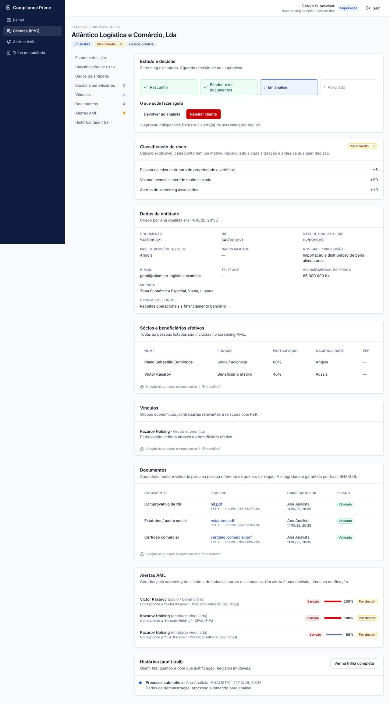
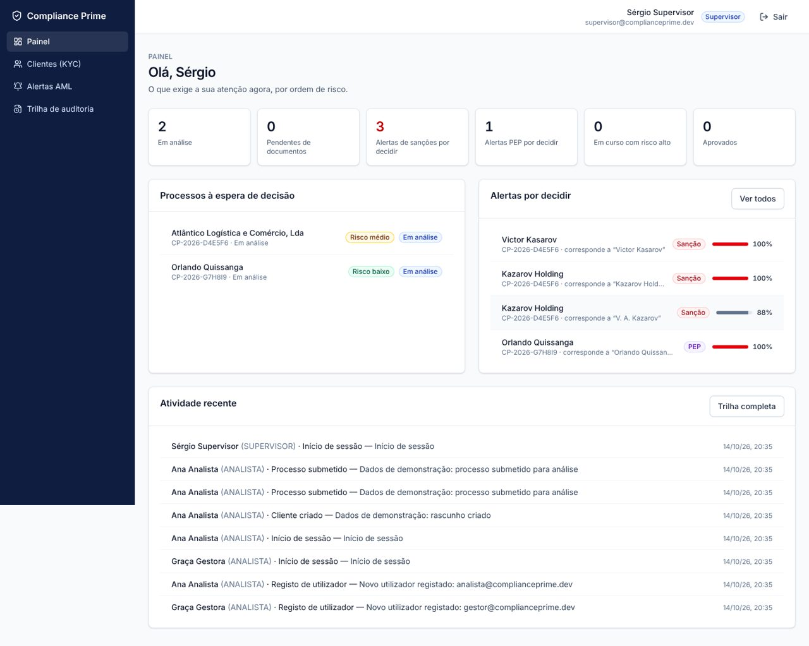
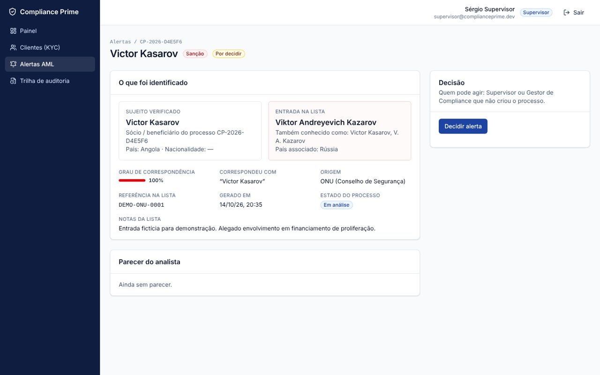
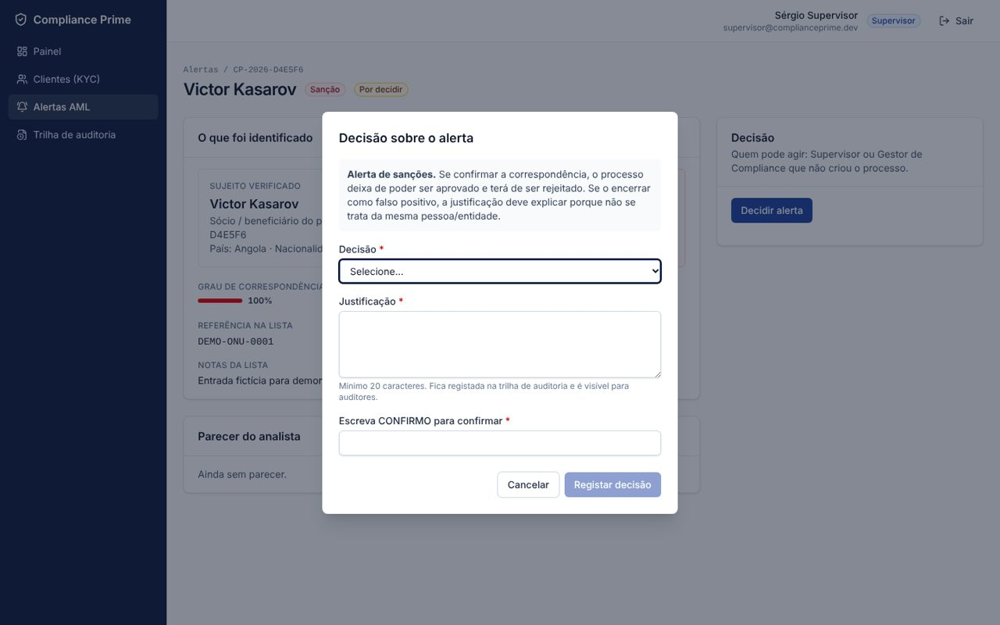

# Compliance Prime

**Plataforma de KYC/AML para instituições financeiras bancárias e não bancárias**: onboarding de clientes, due diligence, screening de sanções e PEP, segregação de funções e trilha de auditoria imutável.

> Compliance não é burocracia digitalizada. É gestão de risco — e a interface é parte do controlo.



## Porque existe

Este projeto nasceu de uma pergunta: *como é, na prática, construir a interface de um sistema de compliance do zero?* Cada decisão de produto parte de um princípio:

| Princípio | Como está implementado |
| --- | --- |
| **O onboarding não é um formulário. É um processo.** | Máquina de estados explícita (`Rascunho → Pendente de documentos → Em análise → Aprovado / Rejeitado`). Cada estado tem UI própria, secções que se bloqueiam e transições com regras verificadas no servidor ([`src/lib/workflow.ts`](src/lib/workflow.ts)). |
| **Pensar em fluxo, não em ecrã.** | A due diligence é uma única página com secções âncora (entidade, sócios e beneficiários, vínculos, documentos, alertas, histórico). O analista vê o contexto completo sem saltos entre abas. |
| **Alertas de sanções/AML não são notificações. São decisões.** | Cada alerta mostra o que foi identificado, a lista de origem, o grau de correspondência e quem pode agir. A decisão exige justificação e dupla confirmação, e recalcula o risco. |
| **Segregação de funções.** | Quatro perfis (Analista, Supervisor, Gestor de Compliance, Auditor) com permissões diferentes. Princípio dos quatro olhos: quem cria um processo não o decide; quem carrega um documento não o valida; risco alto só é aprovado por um Gestor. |
| **O audit trail é para o futuro.** | Todas as ações (incluindo logins falhados e acessos negados) ficam numa tabela *append-only*, protegida por trigger em PostgreSQL. A trilha é filtrável e exportável em CSV para auditores. |

## Funcionalidades

- **Onboarding KYC** de pessoas singulares e coletivas, com documentos obrigatórios por tipo de cliente.
- **Screening AML** do cliente, de sócios/beneficiários efetivos e de entidades vinculadas contra listas de vigilância (ONU, OFAC, UE, PEP nacional, lista interna). Correspondência difusa com Jaro-Winkler, independente de acentos e da ordem dos nomes ([`src/lib/screening.ts`](src/lib/screening.ts)).
- **Classificação de risco explicável**: cada ponto tem um motivo visível (jurisdição, PEP, atividade, volume, alertas) ([`src/lib/risk.ts`](src/lib/risk.ts)).
- **Bloqueios explicados**: em vez de esconder o botão em silêncio, a UI diz porque é que uma aprovação está indisponível (alertas por decidir, documentos por validar, risco alto, quatro olhos).
- **Gestão de documentos** com verificação do conteúdo real (*magic bytes*), limite de tamanho, hash SHA-256 e deteção de duplicados.
- **Painel por perfil**: cada pessoa vê primeiro o que exige a sua ação.
- **Administração de utilizadores**: alteração de perfil e desativação com justificação, terminando as sessões ativas.

## Ecrãs

| Painel por perfil | Alerta como decisão |
| --- | --- |
|  |  |



## Stack

- **Next.js 16** (App Router, Server Components, Server Actions, Proxy) — front-end e back-end no mesmo projeto
- **TypeScript** em modo estrito
- **Better Auth** — autenticação por e-mail/palavra-passe, sessões em base de dados, rate limiting
- **PostgreSQL** + **Drizzle ORM** (migrações SQL versionadas)
- **Zod 4** — os mesmos esquemas validam no cliente e no servidor
- **Tailwind CSS 4**
- **Playwright** (testes ponta-a-ponta) e `node:test` (testes unitários)

## Segurança

Por ser um sistema de conformidade, a segurança é tratada como requisito funcional:

- **Autorização no servidor em cada operação.** Cada Server Action e Route Handler volta a ler a sessão e a verificar o perfil ([`src/server/action-utils.ts`](src/server/action-utils.ts)). Esconder botões é UX, não segurança.
- **Validação dupla** com Zod: feedback imediato no navegador e validação obrigatória no servidor.
- **Perfil e estado lidos sempre da base de dados**, não do cookie. Uma desativação ou mudança de perfil tem efeito imediato e termina as sessões.
- **O perfil não pode ser definido no registo** (`input: false` no Better Auth). Novas contas entram sempre como Analista.
- **Política de palavra-passe forte** (12+ caracteres, maiúsculas, minúsculas, números e símbolos), aplicada também no servidor através de um hook do Better Auth.
- **Rate limiting** persistido em base de dados (5 tentativas de login por minuto por IP).
- **Sessões curtas** (8 horas) e cookies `Secure` quando servido por HTTPS.
- **Content-Security-Policy com nonce por pedido**, `frame-ancestors 'none'`, HSTS, `X-Content-Type-Options`, `Referrer-Policy` e `Permissions-Policy`.
- **Proteção CSRF**: verificação de origem do Better Auth e das Server Actions.
- **Controlo de concorrência otimista** (`version`) e `SELECT … FOR UPDATE` nas transições, para que duas pessoas não decidam o mesmo processo com dados desatualizados.
- **Alteração e registo de auditoria na mesma transação**: ou ficam ambos gravados, ou nenhum.
- **Uploads**: tipo verificado pelo conteúdo, nome sanitizado, download apenas como anexo com `Content-Security-Policy: sandbox` e auditado.
- **Exportação CSV protegida contra injeção de fórmulas.**
- **Proteção contra open redirect** no parâmetro `next` do login.

## Como correr localmente

Requisitos: Node.js 20.9+ e Docker (ou um PostgreSQL 14+).

```bash
git clone https://github.com/<o-seu-utilizador>/compliance-prime.git
cd compliance-prime
npm install

cp .env.example .env
# gere um segredo e coloque-o em BETTER_AUTH_SECRET
openssl rand -base64 32

docker compose up -d          # PostgreSQL em localhost:5432
npm run db:setup              # migrações + dados de demonstração
npm run dev                   # http://localhost:3000
```

### Contas de demonstração

Todas com a palavra-passe `Compliance#2026` (apenas para ambiente local):

| Perfil | E-mail |
| --- | --- |
| Analista | `analista@complianceprime.dev` |
| Supervisor | `supervisor@complianceprime.dev` |
| Gestor de Compliance | `gestor@complianceprime.dev` |
| Auditor | `auditor@complianceprime.dev` |

**Sugestão de percurso:** entre como Analista e crie um onboarding com um beneficiário efetivo chamado “Viktor Kazarov”. Carregue os documentos e submeta. Depois entre como Supervisor para validar os documentos e decidir o alerta, e como Auditor para ver tudo registado na trilha.

> As listas de vigilância e os clientes de exemplo são **totalmente fictícios**.

## Scripts

| Comando | Descrição |
| --- | --- |
| `npm run dev` | Servidor de desenvolvimento |
| `npm run build` / `npm start` | Build e servidor de produção |
| `npm run lint` | ESLint |
| `npm run typecheck` | Tipos de rotas + `tsc --noEmit` |
| `npm test` | Testes unitários (screening, risco, workflow, validação) |
| `npx playwright test` | Testes ponta-a-ponta (requer a app a correr com dados de demonstração) |
| `npm run db:generate` | Gera migração a partir de `src/db/schema.ts` |
| `npm run db:migrate` | Aplica migrações |
| `npm run db:seed` | Dados de demonstração |

## Estrutura

```
src/
├── app/
│   ├── (auth)/            # entrar, registar
│   ├── (app)/             # área autenticada: painel, clientes, alertas, auditoria, admin
│   └── api/               # Better Auth, download de documentos, exportação CSV
├── components/            # UI partilhada e formulários com validação
├── db/                    # esquema Drizzle e ligação
├── lib/                   # regras de negócio puras: workflow, risco, screening, permissões, validação
├── server/                # Data Access Layer, Server Actions, auditoria
└── proxy.ts               # CSP com nonce e verificação otimista de sessão
drizzle/                   # migrações SQL (inclui trigger append-only da auditoria)
tests/                     # unitários (node:test) e e2e (Playwright)
```

As regras de negócio (`src/lib`) são funções puras, sem dependências de framework, e por isso têm testes unitários diretos.

## Em produção

- Defina `BETTER_AUTH_URL` com `https://` (ativa cookies `Secure` e `upgrade-insecure-requests`).
- Use `DATABASE_SSL=true` num PostgreSQL gerido.
- Coloque a aplicação atrás de um proxy que defina `X-Forwarded-For` de forma fiável, porque o rate limiting usa o IP do cliente.
- Considere `ALLOW_SIGNUP=false` e criar contas por convite.
- Para volumes elevados de documentos, mova o armazenamento de `bytea` para um object storage (S3 ou compatível) com cifra em repouso.

## Próximos passos

- Monitorização contínua (re-screening periódico de clientes aprovados quando as listas mudam)
- Importação das listas oficiais (ONU, OFAC, UE) em formato XML
- Revisões periódicas de KYC conforme o nível de risco
- Autenticação multifator (plugin `twoFactor` do Better Auth)

## Autor

[**Madrugada de Carvalho**](https://www.linkedin.com/in/madrugada-de-carvalho-6a0325261) — Software Engineer, especialista em frontend (React · TypeScript), com experiência em sistemas de Compliance, AML e Gestão de Risco.

## Licença

[MIT](LICENSE)
